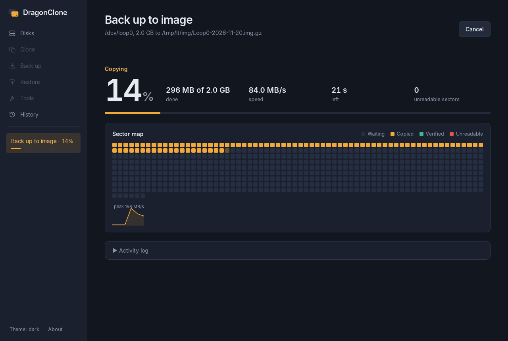
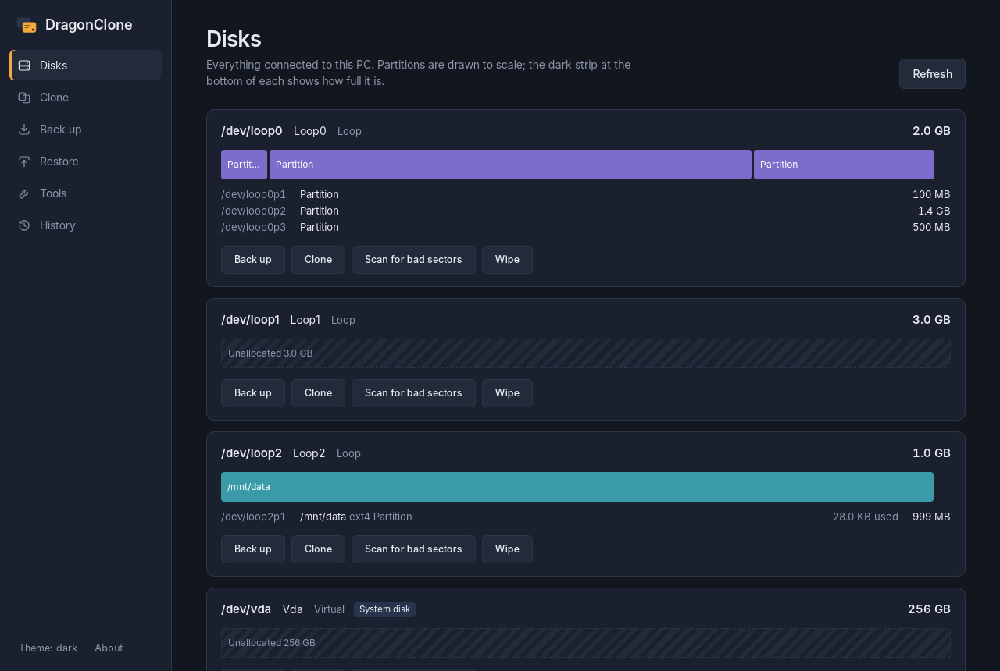
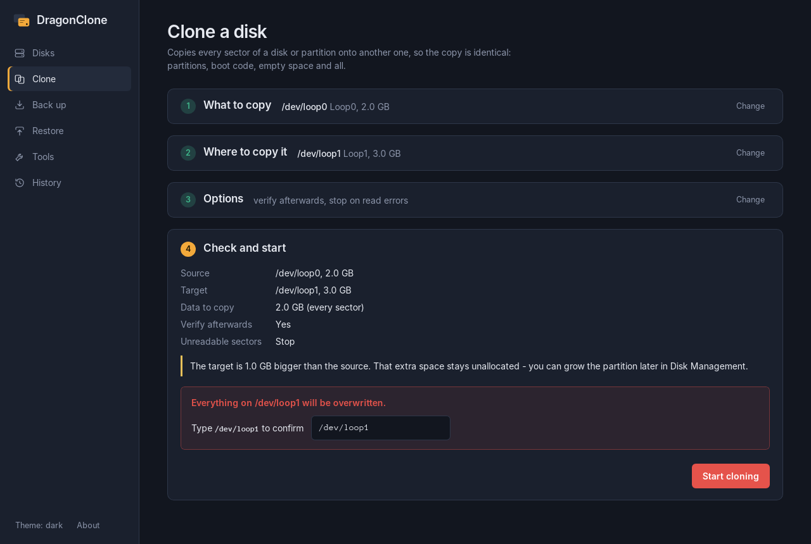

<p align="center"></p>

<h1 align="center">DragonClone</h1>

<p align="center">Sector-by-sector disk cloning, backup images and restores for Windows.<br>
One small .exe, nothing to install.</p>

<p align="center"></p>

## What it does

- **Clone** a disk or partition straight onto another one. Every sector is copied, including partition tables, boot code, hidden and recovery partitions and empty space, so the copy is identical.
- **Back up to an image file**, in one of three formats:
  - **Compressed** (`.img.gz`): usually far smaller than the disk, and uses all your CPU cores. It's a standard gzip file, so 7-Zip or gunzip can open it too.
  - **Raw** (`.img`): byte for byte, works with any other disk tool.
  - **Virtual disk** (`.vhd`): double-click it in Windows to browse the files inside.
- **Restore** `.img`, `.img.gz`, `.vhd` and `.iso` files onto a disk or partition. This also covers flashing a Linux ISO to a USB stick.
- **Verify** after copying: everything is read back and checked block by block, skipping the Windows cache.
- **Tools:**
  - Compare two disks, partitions or images byte by byte.
  - Check that an image still matches the checksum saved when it was made.
  - Surface scan a disk for bad sectors.
  - Wipe a disk with zeros or random data.
  - Mount `.vhd` and `.iso` images read-only.
- **Failing disks:** optionally skip unreadable sectors. DragonClone saves everything it can read, writes zeros where it can't, and lists exactly where those spots are.
- **History:** a list of every operation, plus a log file for each session.

## Getting started

1. Download `DragonClone.exe` from [Releases](../../releases).
2. Double-click it, then choose **Yes** when Windows asks for administrator rights. Raw disk access needs them.
   Because the exe isn't code-signed, SmartScreen may say "Windows protected your PC". Choose **More info**, then **Run anyway**.
3. DragonClone opens in its own window. It shows your disks, and you pick what to do from the sidebar.

Requirements: Windows 10 or 11 (64-bit) with Microsoft Edge, which every current Windows has.

<p align="center">&nbsp;</p>

<sub>The screenshots come from the Linux development build, where the test disks show up as <code>/dev/loopN</code>. On Windows they're listed as Disk 0, Disk 1 and so on, with their real model names and drive letters.</sub>

## Safety

Disk tools can destroy data in one click, so DragonClone is deliberately careful:

- **Typed confirmation.** Before anything is overwritten you have to type the target's name, and you see a list of every volume that will be erased.
- **Things it refuses to do:**
  - overwrite the disk Windows runs or boots from, or the EFI/system partition
  - copy between overlapping areas
  - write to a target that is too small
  - save an image onto the disk being backed up
  - restore an image that sits on its own target
  - write an image bigger than FAT32's 4 GB limit
- **Locking.** Target volumes are locked and dismounted before writing, as Windows requires. Source volumes are locked during the copy so nothing changes underneath it. If something is using them, DragonClone asks you first.
- **Partition table last.** On a real disk, the first block, where the partition table lives, is written last. If a copy is cancelled or fails, the target keeps its old partition table instead of showing half-copied partitions.
- **Unfinished images are deleted.** A failed or cancelled backup doesn't leave a broken image behind.
- **Checksums.** Every image gets a `.json` file next to it with its SHA-256, source and sector size. Restores and "Check an image" verify against it.

## Good to know

- **The target must be at least as big as the source.** On a bigger disk the extra space stays unallocated, and you can extend the partition afterwards in Disk Management.
- **The clone shares its disk ID with the original.** While both are connected, Windows will show one of them as offline ("signature collision"). That's expected for an exact copy, so unplug the original before booting from the clone.
- **The disk Windows is running from** can be copied, but files keep changing during the copy. For a perfectly consistent copy, boot from a WinPE USB stick and run DragonClone there.
- **Sector sizes.** Don't clone between a normal 512-byte-sector disk and a 4K-native one. DragonClone warns you if you try.
- **BitLocker** volumes are copied still encrypted and keep the same recovery key.
- **Mapped network drives** (Z:) aren't visible to programs running as administrator. Use `\\server\share\folder` paths instead.

## How it works

`DragonClone.exe` contains two parts:

- **The launcher** is what you double-click. It runs as a normal user, starts the disk engine with administrator rights (that's the one UAC prompt), and opens the interface in a Microsoft Edge app window. That window has no address bar or tabs, and it uses its own profile, separate from your normal browsing.
- **The engine** is the elevated copy of the same exe. It serves the interface and an API on `127.0.0.1` only:
  - a random token is required on every request
  - requests addressed to any other host name are refused, which blocks DNS-rebinding tricks
  - it never answers cross-origin requests

  If you close the window during a job, the job keeps running. Open DragonClone again and you're back on the progress screen.

Disk access goes through `\\.\PhysicalDriveN` with unbuffered, write-through I/O, and partitions are byte ranges on their disk. Reads and writes overlap, so a disk-to-disk clone runs close to the speed of the slower drive. Unreadable areas are found by splitting the failed block in halves, so a few bad sectors cost a few dozen extra reads rather than thousands.

```
main.go, launcher_*.go   launcher and entry point
server.go, jobs.go       local API, jobs, history, logs
ui/                      the interface (plain HTML/CSS/JS, embedded in the exe)
core/                    the engine: copying, formats, disks
  engine.go              copy, verify, compare, hash, scan, wipe
  image.go, gzip.go      .img / .img.gz / .vhd handling
  platform_windows.go    disks, volumes, locking, Windows APIs
  platform_linux.go      the same for Linux (used for development and tests)
build/windows/           icon, manifest and version info
tools/                   checks the Windows struct layouts against the SDK headers
```

Settings, logs and history are kept in `%LOCALAPPDATA%\DragonClone`.

## Building

DragonClone only needs Go 1.22 or newer. There are no third-party dependencies.

```
go build -trimpath -ldflags "-s -w -H windowsgui" -o DragonClone.exe .
```

Cross-compiling from Linux or macOS works the same way with `GOOS=windows GOARCH=amd64`. The icon, manifest and version info are already compiled into `rsrc_windows_amd64.syso`. If you change them, rebuild that file with mingw-w64:

```
x86_64-w64-mingw32-windres build/windows/dragonclone.rc -O coff -o rsrc_windows_amd64.syso
```

Every push is built and tested on Windows by GitHub Actions. Pushing a tag such as `v1.0.0` publishes a release with the exe attached.

### Tests

```
go test ./...
```

The tests cover:
- exact copies, including partition-table-last ordering
- bad-sector rescue, flaky sectors, devices disappearing mid-copy
- cancelling, padding for 4K-sector targets, and verify catching corruption
- all three image formats: round trips, and damaged archives being detected
- VHD output, checked against `qemu-img` when it's installed
- the parsers for Windows disk structures, using real SDK struct bytes
- the local API's token and host checks

On Linux, run `go run .` as root to use the whole app with loop devices.

## Status

The engine is covered by the tests above, and has been run end to end against real block devices on Linux. Try it on spare drives before trusting it with anything important, and keep a second backup of data you care about. Please report bugs in [Issues](../../issues), and attach the log (History → Open the log).

## License

MIT. See [LICENSE](LICENSE).
